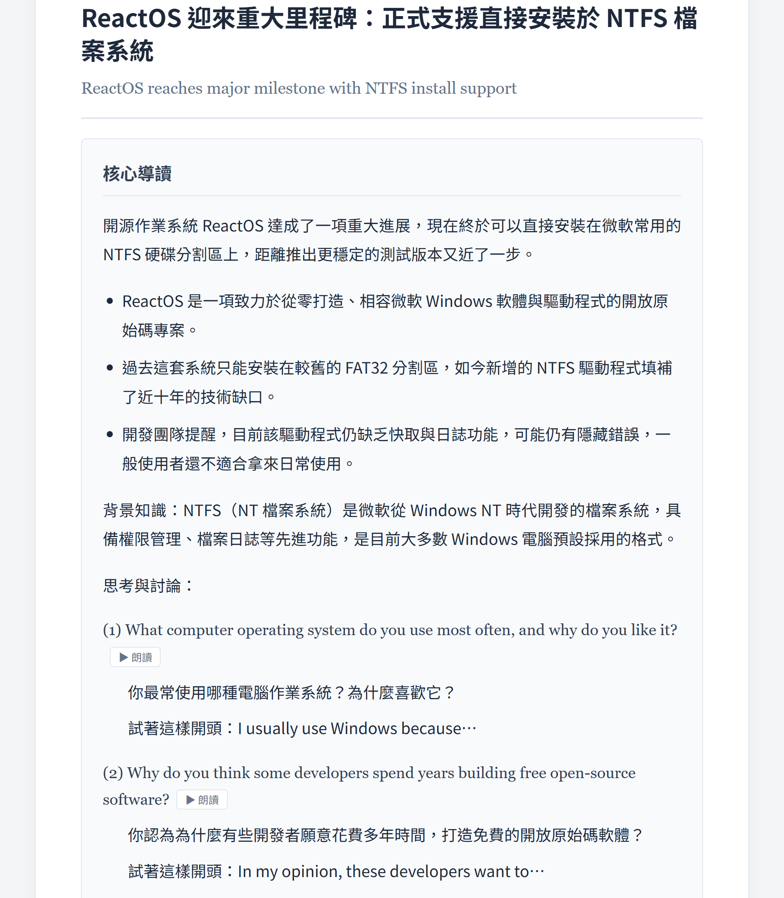
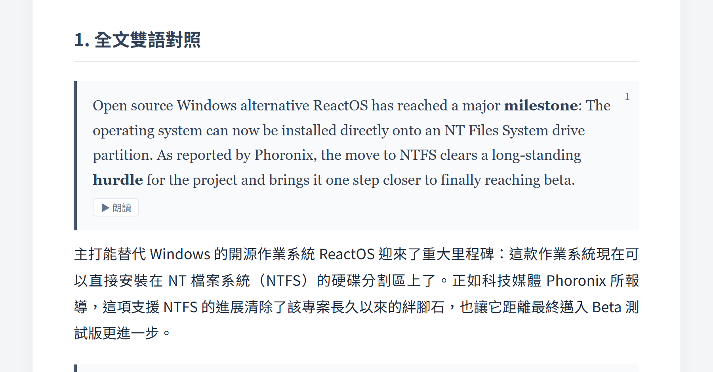
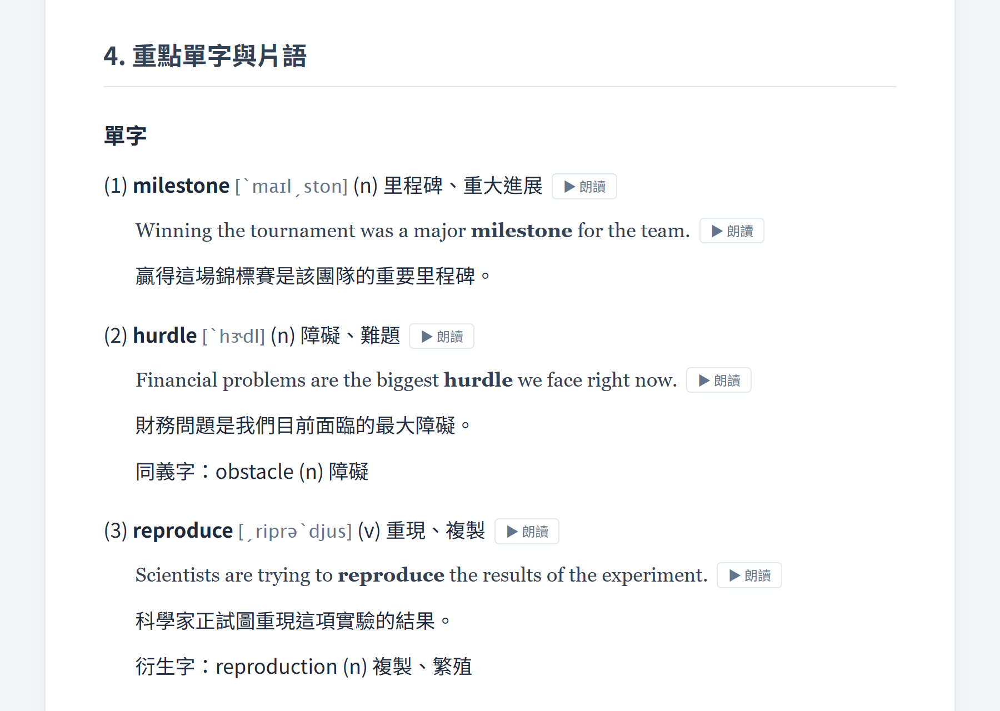

# 阿吉編譯

**A-Ji Compile · v2.12**

阿吉編譯是一個瀏覽器擴充功能。在英文文章頁面按右鍵，就會把文章做成一份給國、高中生閱讀的中英雙語講義，用的是台灣的用語和中文排版。翻譯與筆記由 Google Gemini 產生，需要自己的 Gemini API key。

---

## 講義內容

| 區塊 | 說明 |
|------|------|
| 核心導讀 | 一句話說明文章主旨、3 個重點、背景知識、2 個英文討論問題（附中文翻譯與開頭句型）。預設收合，按上方「核心導讀」展開 |
| 1. 全文雙語對照 | 一段英文原文、一段中文譯文，不刪減。段落有編號，小標題以中英對照呈現 |
| 2. 補充說明 | 文化背景、慣用語、雙關等學生可能看不懂的地方 |
| 3. 文法句型 | 從文中挑 1 到 2 個句型，附文中原句、中文說明與新的例句 |
| 4. 重點單字與片語 | 單字 6 到 8 個（附 KK 音標、詞性、新的例句，以及衍生字、同義字、反義字），片語 3 到 4 個 |

其他功能：

- 可切換僅看中文（只顯示譯文）、僅看英文、深淺色與字級
- 原文裡的重點單字與片語會加粗標示，點一下跳到單字區
- 每段英文原文、單字與例句旁有「朗讀」按鈕，用瀏覽器內建的英文語音唸出來；另存的 HTML 檔用電腦的瀏覽器開啟也能用
- 完成後自動另存成單一 HTML 檔，可離線開啟、列印或傳給學生
- 先選取一段文字再按右鍵，只編譯選取的部分
- 快捷鍵 Alt+J
- 每篇顯示 token 用量與估計費用

---

## 安裝

1. 到 [Releases](../../releases) 下載最新版的 zip 檔，解壓縮到一個固定的資料夾。之後不要搬動或刪除這個資料夾，否則擴充功能會失效。
2. 在瀏覽器網址列輸入 `chrome://extensions`（Brave 為 `brave://extensions`，Edge 為 `edge://extensions`）。
3. 打開右上角的「開發人員模式」，按「載入未封裝項目」，選擇剛才解壓縮的資料夾。
4. 〔截圖〕

---

## 取得 Gemini API key

1. 用 Google 帳號登入 [Google AI Studio](https://aistudio.google.com/apikey)。
2. 按「Create API key」，複製產生的 key。
3. 點瀏覽器右上角的阿吉編譯圖示，貼上 key 並儲存。

〔免費額度大約可以編譯幾篇、用完時會看到什麼訊息〕

注意：使用免費方案時，Google 可能會用送出的內容改進服務；付費方案不會。API key 只存在你自己的瀏覽器裡。

---

## 使用方式

1. 打開一篇英文文章。
2. 在頁面上按右鍵，選「編譯成中英雙語講義」，或按 Alt+J。
3. 會開啟新分頁顯示編譯進度，完成後自動存到「下載／阿吉編譯」資料夾。

在圖示的設定頁可以選擇模型、儲存資料夾，以及是否自動下載。

瀏覽器內建頁面、PDF 檔，以及需要登入卻尚未登入的文章無法擷取。

---

## 注意事項

- 譯文與筆記由 AI 產生，可能有錯誤。發給學生前請先看過。
- 目前不處理圖片與圖表，這些內容不會出現在講義裡。
- 付費媒體的文章請在課堂合理使用的範圍內使用。

---

## 技術說明

- 不需要伺服器，不收集任何資料。文章只會送到 Google Gemini API。
- 權限用途：右鍵選單（contextMenus）、讀取目前分頁的文章（activeTab、scripting）、儲存設定（storage）、另存講義（downloads）。
- 正文擷取使用 [Mozilla Readability](https://github.com/mozilla/readability)（Apache License 2.0，授權條款見 `lib/Readability.LICENSE.md`）。
- 部分設計構想參考 [Shinkansen](https://github.com/jimmysu0309/shinkansen)（Jimmy Su），例如用 Readability 擷取正文、翻譯規則放在系統指令。程式碼與提示文字皆為本專案自行撰寫。

---

## 版本資訊

請見 [Releases](../../releases)。

---

## 授權

本工具採用 [創用 CC 姓名標示-非商業性-相同方式分享 4.0 國際授權條款（CC BY-NC-SA 4.0）](https://creativecommons.org/licenses/by-nc-sa/4.0/deed.zh-hant)。

- **姓名標示**：使用或改作時，須標示原作者。
- **非商業性**：不得用於商業目的。
- **相同方式分享**：改作後再散布，須採用相同授權條款。

完整條款請見 [LICENSE](LICENSE)。

---

## 支持開發

如果這個工具對您有幫助，歡迎透過 Ko-fi 請我喝杯咖啡

---

## 作者

Designed by [@izensun](https://mastodon.social/@izensun)
Built with [Claude](https://claude.ai) (Anthropic)
